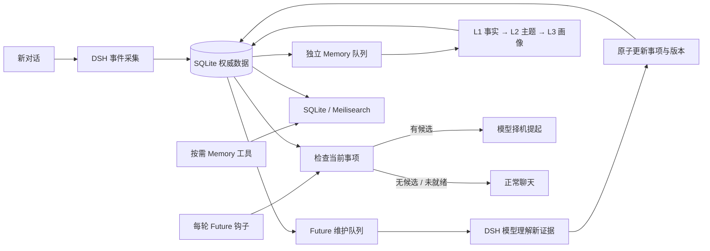

<div align="center">

# dsh-mindsea

### 脑海 · 记得过去，也惦记未来

为 DeepSeek Harness 构建持续的个人上下文。

**被动 Memory · 每轮 Future · 独立事件维护**


[快速开始](#快速开始) · [工作方式](#工作方式) · [分层记忆](#l0l3-分层记忆) · [开发](#开发) · [文档](#文档)

</div>

---

> **今天，是过去的未来。**
>
> 上周你说：“周五要去面试。”
> 今天你只说：“好累。”
>
> 脑海可以在合适时想起那场面试；如果你已经说过“面试取消了”，它也应该先更新这件事，而不是继续追问。

`dsh-mindsea` 把记忆、未来关注点与未闭环事项放在同一个脑海里。SQLite 保存事实和来源，DSH 提供对话钩子与模型能力，Meilisearch 可选接入。

**当前已实现 L0～L3 分层记忆与 DSH 插件：原文证据 → 事实 → 主题 → 长期画像。Memory 按需读取，后台整理与 Future 独立运行。**

## 工作方式

### 需要时回忆，每轮看一眼未来

| 能力       | 什么时候运行       | 做什么                                       |
| :--------- | :----------------- | :------------------------------------------- |
| **Memory** | 模型按需调用工具   | 检索已记住的事实，或显式保存确认的信息       |
| **Future** | 每个聊天回合的钩子 | 检查到期事项和未闭环事项，返回少量候选       |
| **维护**   | 新对话事件到来后   | 独立判断取消、改期、完成和已跟进，不依赖召回 |

Future **有候选**，模型判断是否自然提起；**没有候选**，正常聊天。**更新未完成或服务不可用**，暂缓提示并在后台重试，不能将故障当作“没有事项”。同一回合的内部工具循环不重复检查，新的用户补充会再次触发。



### 已经具备

- **可追溯**：原始事件、来源引用、历史版本和幂等事件写入。
- **可纠正**：版本冲突保护，整批更新与处理进度在同一事务提交。
- **能续接**：维护队列持久化，失败保留任务，重新启动后继续处理。
- **有边界**：用户数据隔离；插件上下文与工具结果不冒充用户原话。
- **轻部署**：默认只需要 Node.js 和本地 SQLite；Meilisearch 故障时回退本地检索。
- **纯 TypeScript**：服务、客户端、后台维护器与 DSH 插件均使用 TypeScript。

## 人员与工作区设置（v0.3 试用）

运行 `npm run settings` 打开本机设置页，创建人员与脑海、选择工作区并生成个人 DSH 配置。默认关闭，服务使用绑定脑海的独立凭据；共享密钥不能再随意选择用户。详见 [试用步骤与当前边界](docs/settings-trial.md)。

当前设置页独立运行，不是 DSH 原生嵌入面板；角色规则与群聊身份适配还未接入。

## 快速开始

### 1. 启动脑海服务

需要 **Node.js 24+**。

```sh
git clone git@github.com:abandon1a2b/dsh-mindsea.git
cd dsh-mindsea
npm ci

# 首次生成后安全保存；服务与 DSH 需要使用同一个密钥。
export MINDSEA_API_KEY="$(openssl rand -hex 32)"
npm start
```

默认地址为 `http://127.0.0.1:4318`，数据保存在 `data/mindsea.sqlite`。

```sh
curl http://127.0.0.1:4318/health
# {"status":"ok"}
```

### 2. 构建 DSH 插件

```sh
npm run build
npm pack ./plugins/dsh-mindsea
```

得到 `dsh-mindsea-0.3.0.tgz`。在目标机器核对 `dsh plugin --help` 后安装，例如：

```sh
dsh plugin --profile web add /absolute/path/dsh-mindsea-0.3.0.tgz
```

插件按 **DSH 0.2.1-rc.2** 的官方类型和运行时代码适配。启动 DSH 的进程应加载设置页生成的个人凭据文件；不要将服务兼容密钥当作个人凭据。

### 3. 配置个人 profile

在 `id: mindsea` 的插件配置中设置：

```yaml
baseUrl: http://127.0.0.1:4318
enabled: false
audience: private
activationFile: /absolute/path/from/settings/activation.json
apiKeyEnv: MINDSEA_PERSONAL_KEY_from_settings
userId: brain-id-from-settings
provider: deepseek
model: deepseek-chat
timeZone: Asia/Shanghai
hookBudgetMs: 5000
pollMs: 1000
sessionIds: []
```

`provider` / `model` 请替换成 DSH 中实际可用的模型路由。`userId` 是可信个人身份；空 `sessionIds` 不会启用全部会话，需匹配工作区规则，不适合直接用于多人共享聊天。维护新对话会产生额外模型调用；Future 检查本身只查询数据。

完整说明：[DSH 插件安装与行为](plugins/dsh-mindsea/README.md)。

<details>
<summary><strong>可选：接入 Meilisearch</strong></summary>

使用本项目专用索引。SQLite 始终是权威数据源，索引可重建。

```sh
export MEILI_URL=http://127.0.0.1:7700
export MEILI_API_KEY=your-server-side-key
export MEILI_INDEX=mindsea_v1
npm start
```

原始对话不进入搜索索引；结构化记忆和事项会复制到配置的实例。默认 SQLite 使用支持中文片段的 FTS5 trigram，当前未实现向量语义检索。

</details>

## L0～L3 分层记忆

L3 的目标是**有证据、可修正、有适用范围的长期画像**。

| 层级                | 作用                         | 当前进度                                  |
| :------------------ | :--------------------------- | :---------------------------------------- |
| **L0 · 原文**       | 保留对话、角色、时间和来源   | 已实现：原文、Unicode 引用与 SHA-256 校验 |
| **L1 · 事实与经历** | 从原文提取可验证的原子事实   | 已实现                                    |
| **L2 · 主题**       | 组织跨会话的发展、变化和例外 | 已实现                                    |
| **L3 · 长期画像**   | 形成稳定偏好、习惯及长期目标 | 已实现                                    |

- 系统推断先成为候选，经用户确认后再激活。
- 同一条原始证据经过多次摘要，仍然只算一份证据。
- 纠正立即使旧结论失效，后台再重建派生记忆。
- “忘记”需要处理根证据和派生记录，避免重放后复活。
- Memory 仍按需检索，Future 始终独立更新。

DSH 已提供被动检索、明确记忆、画像确认、纠错审查和遗忘工具。旧数据通过 schema v3 迁移保留，新增独立任务队列支持租约、重试与人工重建。

阅读 [L0～L3 使用与 API](docs/layered-memory.md) · [设计决策](docs/design/l3-memory.md)。

## 开发

```sh
npm run dev       # 服务热重载
npm run format    # 统一格式
npm run check     # 格式、lint、类型、测试、服务与插件构建
```

```text
src/
├── contracts/           公共协议与校验
├── application/         上下文与维护编排
├── storage/sqlite/      权威数据、事务与 schema
├── search/              可重建检索投影
├── http/                鉴权与分组路由
├── client/              宿主 HTTP 客户端
└── main.ts              服务生命周期
plugins/dsh-mindsea/src/ DSH 事件、模型、Future 钩子与 Memory 工具
test/                   行为回归与架构边界
scripts/                构建辅助
docs/                   设计、协议与开发规范
```

构建产物、密钥和本地数据库不进入仓库。生产代码启用严格类型与 lint；架构测试防止 DSH 插件引用 SQLite、客户端引用服务端实现。详见 [开发规范](docs/development.md)。

## 验证范围

自动测试使用**真实 SQLite 与 HTTP 服务**，覆盖身份隔离、版本冲突、事务回滚、时间边界、重启续接、索引失败回退、独立 Future 更新及 DSH 钩子分支。

**已在官方 DSH 0.2.1 核心运行时验证插件装载、完整回合、后台 L3 整理和卸载；模型使用本地适配器。真实供应商语义质量与真实 Meilisearch 联调仍待验证。** 当前尚无管理界面、主动消息通知或生产负载验证。

## 文档

| 想了解什么             | 从这里开始                                   |
| :--------------------- | :------------------------------------------- |
| 如何安装到 DSH         | [插件指南](plugins/dsh-mindsea/README.md)    |
| 服务接口、配置与状态   | [服务与 API](docs/service-api.md)            |
| 如何形成 L3            | [分层记忆实现与使用](docs/layered-memory.md) |
| 如何接入其他宿主       | [通用接入协议](docs/integration.md)          |
| 如何组织代码与提交变更 | [开发规范](docs/development.md)              |

---

<div align="center">

**dsh-mindsea · 脑海**<br />
记住值得留下的事，在合适的时候接着聊。

</div>
